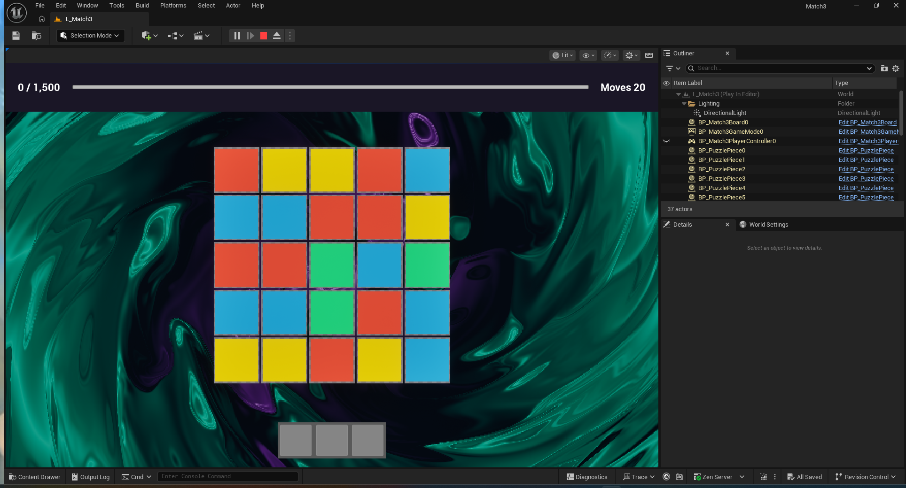
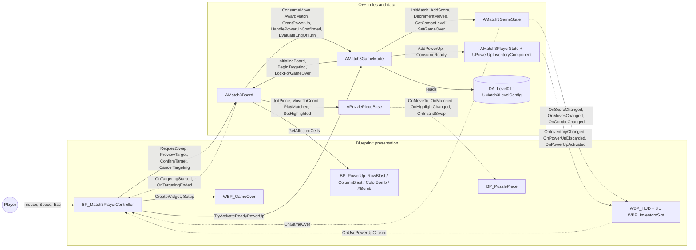
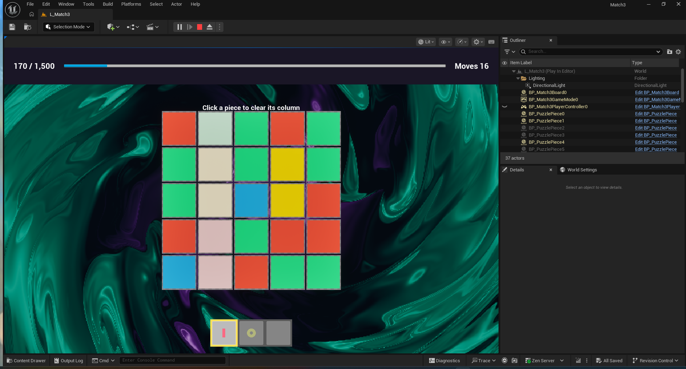
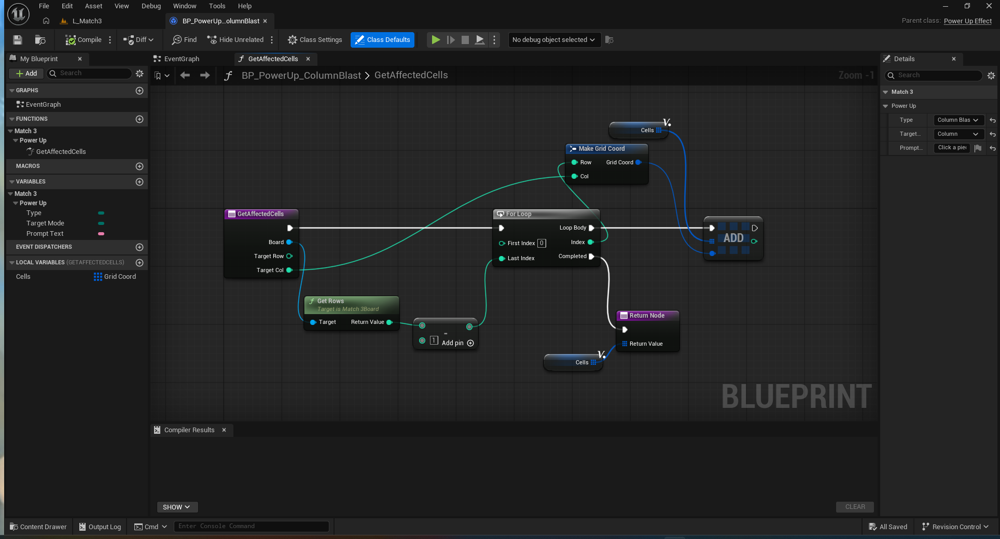

# Match-3 Game Architecture Course (Unreal Engine 5)

A 5×5 match-3 puzzle game built for a 3-hour course on planning a game's programming architecture in Unreal Engine 5 with C++ and Blueprints working together.

**C++ decides, Blueprints show.** C++ owns the rules and the data. Blueprints own the visuals, animation, input and UI.



## Contents

- [The architecture rule](#the-architecture-rule)
- [How the game plays](#how-the-game-plays)
- [Power-ups](#power-ups)
- [Getting started](#getting-started)
- [Branches](#branches)
- [Project layout](#project-layout)
- [Classes](#classes)
- [The course](#the-course)
- [License](#license)

## The architecture rule

Requests travel **down** as function calls, always toward the class that owns the data. Changes travel back **up** as events (delegates and `BlueprintImplementableEvent`s) to whoever wants to show them. Nothing on the Blueprint side writes game state: it asks C++ to act by calling functions such as `RequestSwap`, `TryActivateReadyPowerUp` or `ConfirmTarget`.



Solid arrows are function calls. Dashed arrows are events.

A few habits follow from the rule:

- `AMatch3GameMode` is the only writer of game state. `AMatch3GameState`'s setters are C++ only (the GameMode is a friend class), so Blueprints can read the score but never set it.
- Blueprints cast to the C++ classes (`Match3GameMode`, `Match3Board`, `PuzzlePieceBase`), never to each other, so every Blueprint depends on C++ and not on another Blueprint.
- The HUD binds to delegates once and never polls. No UMG property bindings that run every frame.
- C++ timers own the timing (swap 0.20 s, clear 0.25 s, fall 0.30 s). Blueprint timelines play at `1 / Duration`, so animations always fit the time C++ gives them.

The board is always in exactly one state: `Initializing`, `Idle`, `Swapping`, `Resolving`, `Targeting` or `GameOver`. Input is accepted only in `Idle` and `Targeting`.

## How the game plays

| Rule | Detail |
|---|---|
| Board | 5×5, four colors (red, blue, green, yellow). The first fill never starts with a match. |
| Swipe | Hold the left mouse button on a piece and drag. The dominant axis picks up, down, left or right, and the piece swaps with that neighbor. |
| Moves | 20. Every swap costs one move, even with no match, and swaps never revert. A swipe off the board edge shakes the piece and costs nothing. |
| Matches | Three or more in a row or column clear. Score = 10 × Count × (Count − 2) × ComboLevel. |
| Cascades | Pieces fall, the board refills, and new matches keep resolving. ComboLevel goes up each cascade and resets each turn. |
| Win / lose | Win when the score reaches 1,500. Lose when moves reach 0 first. Checked only after the board settles. |

### Controls

| Input | Action |
|---|---|
| Left mouse, hold and drag | Swipe a piece |
| Space, or click inventory slot 0 | Use the ready power-up |
| Left click (while targeting) | Confirm the target |
| Esc or right click (while targeting) | Cancel and keep the power-up |

## Power-ups



A matched piece carrying a power-up icon adds that power-up to the inventory. The inventory is a first-in, first-out queue with three slots. Slot 0 is the ready one, and only that one can be used. A fourth power-up discards slot 0 and the rest move forward. Using a power-up costs no move, and it is consumed only when the target is confirmed. Blast cells score 10 × CellCount, then the board cascades normally. Power-ups caught in a blast are not collected.

| Power-up | Effect |
|---|---|
| Row Blast | Click a piece to clear its row. |
| Column Blast | Click a piece to clear its column. |
| Color Bomb | Click a piece to clear every piece of that color. |
| X Bomb | Click a piece to clear it and both full diagonals out to the board edges. |

Each power-up is a Blueprint child of the C++ `UPowerUpEffect` and only answers one question, `GetAffectedCells`. The board does the clearing, scoring and cascading. Here is the whole of `BP_PowerUp_ColumnBlast`:



## Getting started

### Requirements

- Unreal Engine 5.8 (the project uses Enhanced Input).
- Visual Studio 2022 with the **Game development with C++** workload, plus the **Unreal Engine installer** and a Windows SDK from its optional components. The compiled binaries aren't in the repo, so you build the C++ module yourself.

### Open the project

1. Clone the repo and check out the branch you need (see [Branches](#branches)).
2. Right-click `Match3.uproject` and choose **Generate Visual Studio project files** (on Windows 11, under *Show more options*).
3. Double-click `Match3.uproject`. When it says modules are missing or out of date, click **Yes** to build them.
4. The editor opens on `L_Match3`. Press **Play**.

### Editor settings

These live on each machine, not in the repo, so set them once:

1. **Esc stops Play In Editor by default**, but the game uses Esc to cancel a power-up. In *Editor Preferences > General > Keyboard Shortcuts*, search "Stop" and change *Play World > Stop* to Shift+Escape. (Right click also cancels, if you skip this.)
2. In *Editor Preferences > Level Editor > Play*, turn on **Game Gets Mouse Control** so the first click goes to the game.
3. Keep the net mode on **Play Standalone**. The HUD and the board read the GameMode, which exists only on the server.
4. Shift+F1 frees the mouse during play.

### Troubleshooting

| Problem | Fix |
|---|---|
| **Generate Visual Studio project files** is missing from the right-click menu | Windows doesn't know which engine owns `.uproject` files. Run `UnrealVersionSelector.exe` once from your 5.8 install (`Engine/Binaries/Win64`), or right-click `Match3.uproject` > **Switch Unreal Engine version** and pick 5.8. |
| "The following modules are missing or built with a different engine version", and the rebuild fails | The C++ toolchain isn't set up. Check the Visual Studio workload and components in [Requirements](#requirements). For the real error, open `Match3.sln`, set **Development Editor / Win64** and build the `Match3` project. |
| The editor offers to convert or open a copy of the project | You opened it with another engine version. Use Unreal Engine 5.8. |
| The editor opens on an empty level | Open `Content/Maps/L_Match3`. |
| A C++ change compiles, but Blueprints show errors or old values | Live Coding can't hot-reload changes to a header (new `UPROPERTY`, `UFUNCTION` or struct fields). Close the editor, build from Visual Studio, and reopen it. |
| Pressing Esc ends Play instead of cancelling a power-up | Rebind *Play World > Stop* (see [Editor settings](#editor-settings)), or cancel with right click. |
| The first click in Play does nothing | Turn on **Game Gets Mouse Control**. |
| The board or HUD is empty, or nothing reacts to input | The net mode isn't **Play Standalone**. |
| The mouse is stuck inside the game window | Press Shift+F1. |
| "No EffectClass for EPowerUpType::…" in the Output Log | That power-up's **Effect Class** is empty in `DA_Level01`. |

On `course-started`, some of this is expected until you finish the TODOs: matches don't clear until the `FindMatches` solution is uncommented, swipes do nothing until the controller's swipe handling is in, the HUD doesn't update until `InitHUD` binds its delegates, and the X Bomb clears nothing until its `GetAffectedCells` is done.

## Branches

| Branch | What it holds |
|---|---|
| `main` | The empty Blank C++ project. A clean reset point. |
| `develop` | Day-to-day work. Everything is built and tested here first. |
| `complete-course` | The finished reference project, handed out after class. It only receives merges from `develop`. |
| `course-started` | What students open at the start of class: `complete-course` with the student TODO parts removed. The C++ TODOs keep their solution commented out in place. It still compiles and runs; the board just doesn't clear until `FindMatches` is uncommented. |

Fixes go into `develop` and flow forward: `develop` → `complete-course` → `course-started`.

## Project layout

```
Match3.uproject
Config/
Source/Match3/
  Core/       Match3Types.h: enums, FGridCoord, FMatchResult, delegates
  Board/      AMatch3Board, APuzzlePieceBase
  Rules/      GameMode, GameState, PlayerState, inventory, level config
  PowerUps/   UPowerUpEffect
Content/
  Board/      BP_Match3Board, BP_PuzzlePiece, piece, tile and backdrop materials
  Maps/       L_Match3
  Player/     BP_Match3PlayerController, Enhanced Input actions and mapping context
  PowerUps/   the four power-up Blueprints, icon material and textures
  Rules/      BP_Match3GameMode, DA_Level01
  UI/         WBP_HUD, WBP_InventorySlot, WBP_GameOver
SourceArt/Icons/   source PNGs for the power-up icons
Docs/Images/       screenshots used in this README
```

The animated purple and teal swirl behind the board is `M_SwirlBackdrop` (an unlit material with a Custom HLSL node, ported from the Balatro background shader) on a `Backdrop` plane in `BP_Match3Board`. Its colors and speeds live in `MI_SwirlBackdrop`. It sits in the world under the board rather than in a widget, because UMG always draws on top of the 3D view.

## Classes

| C++ (rules and data) | Role |
|---|---|
| `AMatch3GameMode` | The only writer of game state. Spawns the board, applies rules, ends the game. |
| `AMatch3GameState` | Score, MovesRemaining, TargetScore, ComboLevel, and the delegates the HUD listens to. |
| `AMatch3PlayerState` | Owns `UPowerUpInventoryComponent`, the three-slot power-up queue. |
| `AMatch3Board` | The grid and its state machine: swap, find matches, clear, gravity, refill, targeting. |
| `APuzzlePieceBase` | Abstract piece data, plus the events its Blueprint child animates. |
| `UPowerUpEffect` | Blueprintable base for power-ups: `GetTargetMode`, `GetAffectedCells`. |
| `UMatch3LevelConfig` | Data asset with board size, moves, target score, timing and power-up settings. |

| Blueprint (presentation) | Role |
|---|---|
| `BP_Match3GameMode` | Asset wiring: which board, piece and config to use. |
| `BP_Match3Board` | Camera, background tiles and the swirl backdrop. |
| `BP_PuzzlePiece` | Timelines for move, pop and shake, and the target highlight. |
| `BP_PowerUp_RowBlast`, `ColumnBlast`, `ColorBomb`, `XBomb` | Each returns the cells its effect clears. |
| `BP_Match3PlayerController` | Enhanced Input (`IA_Press`, `IA_UsePowerUp`, `IA_Cancel`), swipe detection, targeting input. |
| `WBP_HUD`, `WBP_InventorySlot`, `WBP_GameOver` | Score, moves, inventory and the game-over screen with restart. |
| `DA_Level01` | The level's settings. |

## The course

Students already know their way around the editor, have used Blueprints and know some C++. They open `course-started` and fill in these parts:

| Language | Student TODO |
|---|---|
| C++ | `AMatch3Board::FindMatches` |
| C++ | `UPowerUpInventoryComponent::AddPowerUp`, `ConsumeReady` |
| C++ | `AMatch3GameMode::ConsumeMove`, `EvaluateEndOfTurn` |
| Blueprint | `BP_Match3PlayerController` swipe handling and `ComputeSwipeDirection` |
| Blueprint | `BP_PowerUp_XBomb.GetAffectedCells` |
| Blueprint | `WBP_HUD.InitHUD` delegate bindings |

The C++ TODOs come with the full solution already written but commented out, with `// Step N:` comments that walk through the algorithm. Students read the steps, delete the `/*` and `*/` around the solution and the placeholder `return` under it (where there is one), then build. The Blueprint TODOs are built from scratch.

| Time | Session |
|---|---|
| 0:00 | Architecture talk |
| 0:25 | Swipe input (Blueprint) |
| 0:55 | `FindMatches` (C++) |
| 1:30 | Break |
| 1:40 | GameMode rules and HUD delegates |
| 2:05 | Inventory (C++) |
| 2:30 | X Bomb (Blueprint) |
| 2:55 | Recap |

## License

[MIT](LICENSE) © 2026 José Javier Serrano Solís